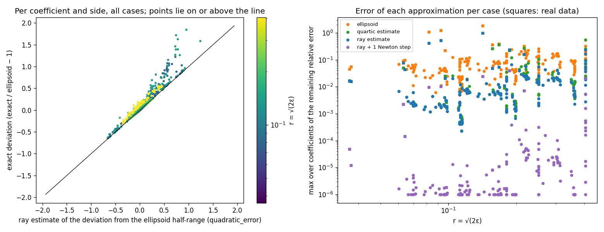

# Evaluation

Generated by `scripts/evaluate.py`; raw numbers in `docs/_static/evaluation.json`. All datasets are real. For each one a scikit-learn `LogisticRegression` is fitted on standardized features with `C` chosen by 5-fold cross-validation on log-loss, then audited with `audit()` at three tolerances: the default `"cv"` (one standard error of the cross-validated loss), 1% and 3% of the optimal training loss.

The point of the evaluation is to compare three ways of computing the same quantities:

- **exact**: coefficient ranges by convex optimization (`coef_extremes`), flips by the hyperplane test (`can_flip`);
- **sampled**: the same quantities over 2,000 hit-and-run draws with ellipsoid proposals;
- **ellipsoid**: the Hessian-ellipsoid approximation (`coef_intervals`, `hacking_interval`).

## Datasets

| Dataset | n | d | Source |
|---|--:|--:|---|
| Breast Cancer PCA-10 | 569 | 10 | sklearn, first 10 principal components |
| Breast Cancer full | 569 | 30 | sklearn |
| German Credit | 1,000 | 61 | UCI via OpenML (id 31), one-hot encoded |
| Adult Census | 5,000 of 30,162 | 101 | UCI, one-hot encoded, random subsample |

## Results

"Sampled range coverage" is the median over coefficients of (sampled range width) / (exact range width). "Ellipsoid / exact width" is the median (minimum, maximum) over coefficients of the ratio of the ellipsoid coefficient interval's width to the exact range's; the per-side position of the bounds is examined in the section after next.

| Dataset | n | d | C | tolerance | ╬╡ / loss | flip rate: exact | sampled | ellipsoid | sign-stable: exact | sampled | sampled range coverage | ellipsoid / exact width | min ESS |
|---|--:|--:|--:|---|--:|--:|--:|--:|--:|--:|--:|--:|--:|
| Breast Cancer PCA-10 | 569 | 10 | 10 | cv | 34.3% | 24.4% | 12.8% | 35.9% | 2/10 | 3/10 | 73% | 0.95x (min 0.90x, max 0.99x) | 51 |
| Breast Cancer PCA-10 | 569 | 10 | 10 | 0.01 | 1.0% | 1.8% | 1.6% | 1.9% | 9/10 | 9/10 | 77% | 1.00x (min 1.00x, max 1.00x) | 350 |
| Breast Cancer PCA-10 | 569 | 10 | 10 | 0.03 | 3.0% | 4.0% | 3.2% | 4.2% | 7/10 | 9/10 | 75% | 1.00x (min 0.99x, max 1.00x) | 252 |
| Breast Cancer full | 569 | 30 | 1 | cv | 26.3% | 27.6% | 8.4% | 35.0% | 0/30 | 0/30 | 50% | 1.00x (min 0.92x, max 1.08x) | 58 |
| Breast Cancer full | 569 | 30 | 1 | 0.01 | 1.0% | 2.8% | 0.9% | 3.2% | 14/30 | 23/30 | 53% | 1.00x (min 0.99x, max 1.01x) | 319 |
| Breast Cancer full | 569 | 30 | 1 | 0.03 | 3.0% | 6.2% | 2.5% | 6.7% | 3/30 | 15/30 | 52% | 1.00x (min 0.97x, max 1.03x) | 179 |
| German Credit | 1000 | 61 | 0.03 | cv | 2.6% | 79.0% | 38.3% | 80.8% | 0/61 | 9/61 | 40% | 1.00x (min 0.90x, max 1.00x) | 134 |
| German Credit | 1000 | 61 | 0.03 | 0.01 | 1.0% | 56.8% | 25.1% | 57.5% | 3/61 | 17/61 | 40% | 1.00x (min 0.95x, max 1.00x) | 195 |
| German Credit | 1000 | 61 | 0.03 | 0.03 | 3.0% | 82.9% | 41.7% | 84.8% | 0/61 | 8/61 | 40% | 1.00x (min 0.89x, max 1.00x) | 143 |
| Adult Census (5k rows) | 5000 | 101 | 0.03 | cv | 1.3% | 47.7% | 11.2% | 50.9% | 3/101 | 27/101 | 22% | 0.98x (min 0.49x, max 1.24x) | 6 |
| Adult Census (5k rows) | 5000 | 101 | 0.03 | 0.01 | 1.0% | 42.2% | 9.8% | 45.5% | 4/101 | 33/101 | 23% | 0.99x (min 0.53x, max 1.24x) | 6 |
| Adult Census (5k rows) | 5000 | 101 | 0.03 | 0.03 | 3.0% | 67.8% | 14.8% | 72.6% | 1/101 | 19/101 | 19% | 0.96x (min 0.37x, max 1.22x) | 4 |

## What the table shows

**Sampled quantities understate, and the gap grows with dimension.** With 2,000 draws the sampled coefficient ranges cover 73–77% of the exact range at d = 10, about half at d = 30, 40% at d = 61 and about 20% at d = 101. Sampled flip rates are a third to a quarter of the exact ones on German Credit and Adult. Sign stability judged from samples is correspondingly too optimistic: on German Credit at a 1% tolerance, samples call 17 of 61 coefficients sign-stable where the exact ranges leave 3. This is why `audit()` computes coefficient ranges and flips exactly whenever the problem size allows, and labels them as sampled lower bounds otherwise.

**The Hessian ellipsoid gets the widths right and the bounds less so.** The median ratio of ellipsoid width to exact width is 0.95–1.00 on every dataset, but a width ratio hides where the interval sits: on Adult the exact lower bound of one rare one-hot coefficient lies 1.2 ellipsoid half-widths below the ellipsoid's lower bound (next section), while the width ratio for that coefficient is 1.8. Its flip screen matches the exact flip rate to within a few points at 1–3% tolerances and overestimates when the tolerance is a large fraction of the loss (36% vs 24% on Breast Cancer PCA-10 at the `"cv"` tolerance, which there is 34% of the optimal loss). An earlier version of this page reported the ellipsoid as 4–8x too wide in high dimension; that comparison was against *sampled* widths, which is what was too narrow. A later version said the ellipsoid was "within 24% in the worst coordinate"; that was the maximum of the width ratio and missed the coefficients where the ellipsoid is too narrow (minimum 0.37–0.53x on Adult, now in the table).

**Effective sample size.** At 1–3% tolerances, 2,000 hybrid draws give a minimum ESS of 130–350 for d ≤ 61. The `"cv"` tolerance on the small breast-cancer sets defines much larger sets (ε of 26–34% of the loss), where the ellipsoid proposals are accepted less often and ESS falls to about 50. At d = 101 the chain does not mix (ESS of 4–6) and sampled quantities, including the disagreement figure, should not be read as estimates; the exact quantities are unaffected.

**The multiplicity itself.** Breast cancer at a 1% tolerance: 2–3% of rows can flip, and 9 of 10 principal-component coefficients (14 of 30 raw ones) keep their sign. German Credit at the same tolerance: 57% of applicants could be classified either way by some model within 1% of the best log-loss, and only 3 of 61 coefficients have a determined sign. Adult: 42% of rows and 4 of 101 coefficients. Credit and income data are known to admit many near-equivalent linear classifiers (Marx, Calmon & Ustun 2020); the figures here are the exact version of that observation for these fits.

## Exact ranges against the quadratic approximation

Generated by `scripts/exact_vs_quadratic.py` (raw numbers in `docs/_static/exact_vs_quadratic.json`; about eight minutes). The question is when the exact computation differs from the Hessian ellipsoid, and what it takes to estimate the difference without the full convex program.

The ellipsoid puts the extremes of coefficient $j$ at $\hat\theta_j \pm r\,\mathrm{sd}_j$, $r = \sqrt{2\varepsilon}$, attained at $\hat\theta \pm r u_j$ with $u_j = H^{-1}e_j/\lVert e_j \rVert_{H^{-1}}$. Three estimates of the exact extremes were tested (`RashomonSet.quadratic_error`). The **quartic estimate** replaces the loss along the ray by its Taylor expansion to fourth order: a closed form, computed from $\hat\theta$ alone. The **ray estimate** solves $L(\hat\theta + t u_j) = \hat L + \varepsilon$ on the true loss by one-dimensional bisection, $O(n)$ per evaluation; its boundary points are in the set, so it is an inner bound, and the exact range is wider only when the set's extreme point is off the ray. The **Newton estimate** starts from the ray boundary point and takes one step of the exact program's iteration, using the gradient and Hessian *at the boundary*, then returns to the level set along the step; it is still an inner bound and costs one Hessian build per functional. All three are compared with the exact ranges per coefficient and per side, as relative deviations from the ellipsoid half-range. For flips, each construction gives a screen (the row's margin range, estimated the same way) that is compared with the exact test on 300 rows per case. The posterior mass of the exact set under the Laplace posterior is compared with its nominal value $F_{\chi^2_d}(2n\varepsilon)$. Cases: the datasets above at the same three tolerances, the unpenalized UCLA admissions fit at the profile and likelihood-ratio tolerances, and a synthetic grid (n ∈ {200, 1000}, d ∈ {5, 20}, standard deviation of the linear predictor ∈ {0.5, 2, 5}, equicorrelation ∈ {0, 0.95}, scikit-learn C ∈ {1, 100}, four tolerances; 192 cases).

<!-- generated: exact_vs_quadratic -->
| Dataset | d | tolerance | ε / loss | r = √(2ε) | posterior mass: nominal | observed | remaining error, max over coefficients: ellipsoid | ray | ray + 1 Newton step | quartic | flips (exact / ellipsoid / ray / Newton) | rows misclassified: ellipsoid | ray | Newton | seconds: exact ranges | Newton |
|---|--:|---|--:|--:|--:|--:|--:|--:|--:|--:|---|--:|--:|--:|--:|--:|
| Breast Cancer PCA-10 | 11 | cv | 34.3% | 0.217 | 0.995 | 0.977 | 31.7% | 15.5% | 0.7% | 27.1% | 23.0% / 34.7% / 20.7% / 23.0% | 11.7% | 2.3% | 0.0% | 0.1 | 0.0 |
| Breast Cancer PCA-10 | 11 | 0.01 | 1.0% | 0.037 | 0.000 | 0.000 | 5.4% | 1.6% | 0.0% | 1.5% | 1.3% / 1.7% / 1.3% / 1.3% | 0.3% | 0.0% | 0.0% | 0.0 | 0.0 |
| Breast Cancer PCA-10 | 11 | 0.03 | 3.0% | 0.064 | 0.003 | 0.002 | 9.4% | 4.3% | 0.0% | 4.4% | 3.3% / 3.7% / 3.3% / 3.3% | 0.3% | 0.0% | 0.0% | 0.1 | 0.0 |
| Breast Cancer full | 31 | cv | 26.3% | 0.187 | 0.061 | 0.055 | 22.9% | 23.6% | 3.9% | 21.9% | 25.7% / 32.0% / 22.3% / 25.3% | 6.3% | 3.3% | 0.3% | 0.3 | 0.1 |
| Breast Cancer full | 31 | 0.01 | 1.0% | 0.036 | 0.000 | 0.000 | 4.4% | 1.6% | 0.0% | 1.6% | 1.7% / 2.3% / 1.7% / 1.7% | 0.7% | 0.0% | 0.0% | 0.2 | 0.1 |
| Breast Cancer full | 31 | 0.03 | 3.0% | 0.063 | 0.000 | 0.000 | 9.1% | 7.5% | 0.2% | 5.0% | 5.0% / 5.7% / 4.7% / 5.0% | 0.7% | 0.3% | 0.0% | 0.2 | 0.1 |
| German Credit | 62 | cv | 2.6% | 0.157 | 0.000 | 0.000 | 35.9% | 4.8% | 0.0% | 25.7% | 82.3% / 84.0% / 82.3% / 82.3% | 1.7% | 0.0% | 0.0% | 1.3 | 0.3 |
| German Credit | 62 | 0.01 | 1.0% | 0.097 | 0.000 | 0.000 | 21.7% | 2.0% | 0.0% | 2.5% | 61.0% / 61.7% / 61.0% / 61.0% | 0.7% | 0.0% | 0.0% | 1.1 | 0.4 |
| German Credit | 62 | 0.03 | 3.0% | 0.168 | 0.000 | 0.000 | 38.2% | 5.3% | 0.0% | 36.1% | 84.0% / 85.7% / 83.7% / 84.0% | 1.7% | 0.3% | 0.0% | 1.3 | 0.3 |
| Adult Census (5k rows) | 102 | cv | 1.3% | 0.093 | 0.000 | 0.000 | 121.9% | 51.1% | 1.0% | no boundary | 52.3% / 54.7% / 52.3% / 52.3% | 2.3% | 0.0% | 0.0% | 17.1 | 4.6 |
| Adult Census (5k rows) | 102 | 0.01 | 1.0% | 0.082 | 0.000 | 0.000 | 105.6% | 40.7% | 0.9% | no boundary | 47.7% / 50.3% / 47.0% / 47.7% | 2.7% | 0.7% | 0.0% | 17.2 | 4.7 |
| Adult Census (5k rows) | 102 | 0.03 | 3.0% | 0.142 | 0.484 | 0.206 | 184.2% | 97.6% | 2.4% | no boundary | 71.0% / 74.7% / 70.3% / 71.0% | 3.7% | 0.7% | 0.0% | 18.5 | 4.5 |
| UCLA admissions (unpenalized) | 6 | profile | 0.8% | 0.098 | 0.302 | 0.309 | 3.6% | 0.3% | 0.0% | 0.3% | 23.7% / 23.7% / 23.7% / 23.7% | 0.0% | 0.0% | 0.0% | 0.1 | 0.0 |
| UCLA admissions (unpenalized) | 6 | lr | 2.7% | 0.177 | 0.950 | 0.951 | 7.5% | 1.1% | 0.0% | 0.9% | 49.0% / 50.7% / 49.0% / 49.0% | 1.7% | 0.0% | 0.0% | 0.0 | 0.0 |

Synthetic grid, binned by r = √(2ε); each entry is the max over coefficients, then the median or worst case in the bin:

| r | cases | ellipsoid: median | worst | ray: median | worst | ray + 1 Newton step: median | worst | quartic: median | worst | rows misclassified, worst case: ellipsoid | ray | Newton | posterior mass, observed − nominal: worst |
|---|--:|--:|--:|--:|--:|--:|--:|--:|--:|--:|--:|--:|--:|
| 0.05–0.1 | 32 | 4.1% | 6.9% | 0.2% | 0.7% | 0.0% | 0.0% | 0.2% | 0.7% | 2.0% | 0.5% | 0.0% | 0.010 |
| 0.1–0.2 | 89 | 4.2% | 24.0% | 0.4% | 6.6% | 0.0% | 0.0% | 0.4% | 11.9% | 7.5% | 4.5% | 0.0% | 0.014 |
| 0.2–0.4 | 59 | 9.3% | 25.5% | 1.7% | 5.7% | 0.0% | 0.0% | 1.9% | 10.4% | 8.5% | 2.5% | 0.0% | 0.041 |
| 0.4–inf | 12 | 16.2% | 54.9% | 5.0% | 23.4% | 0.0% | 2.0% | 5.2% | 56.1% | 17.0% | 7.0% | 0.0% | 0.076 |

Synthetic cases where the ray estimate leaves the most unexplained:

| case | tolerance | ε / loss | r | saturated rows | ellipsoid | ray | ray + 1 Newton step | quartic |
|---|---|--:|--:|--:|--:|--:|--:|--:|
| n=200 d=20 signal=5 rho=0 C=100 | lr | 45.1% | 0.404 | 68% | 54.9% | 23.4% | 2.0% | 56.1% |
| n=200 d=20 signal=5 rho=0.95 C=100 | lr | 33.6% | 0.404 | 54% | 32.6% | 16.8% | 0.5% | 26.1% |
| n=200 d=20 signal=2 rho=0.95 C=100 | lr | 22.7% | 0.404 | 34% | 16.7% | 9.1% | 0.2% | 9.7% |
| n=200 d=20 signal=5 rho=0 C=1 | lr | 33.7% | 0.404 | 44% | 21.7% | 7.2% | 0.0% | 9.5% |
| n=200 d=20 signal=2 rho=0 C=100 | lr | 17.7% | 0.404 | 16% | 23.8% | 7.1% | 0.1% | 7.6% |

All cases, grouped by how far the ray estimate itself departs from the ellipsoid (max over coefficients):

| ray estimate's deviation from the ellipsoid | cases | exact − ray, max over coefficients: median case | worst case | exact − Newton: worst case | rows misclassified by the ellipsoid screen: worst | by the ray screen: worst | by the Newton screen: worst |
|---|--:|--:|--:|--:|--:|--:|--:|
| 0%–5% | 97 | 0.2% | 3.7% | 0.0% | 7.0% | 1.7% | 0.0% |
| 5%–10% | 57 | 0.7% | 4.3% | 0.0% | 6.5% | 1.3% | 0.0% |
| 10%–20% | 38 | 2.1% | 9.1% | 0.2% | 8.5% | 3.0% | 0.0% |
| 20%–50% | 11 | 6.6% | 23.6% | 3.9% | 17.0% | 7.0% | 0.3% |
| over 50% | 3 | 51.1% | 97.6% | 2.4% | 3.7% | 0.7% | 0.0% |

Smallest signed (exact − estimate) deviation over all 6444 coefficient sides in 206 cases: ray 6.0e-06, Newton -1.3e-06 (neither estimate exceeded the exact range beyond the loss tolerance). Largest |observed − nominal| posterior mass: 0.277.
<!-- /generated -->



**Where the ellipsoid is wrong.** At 1–3% tolerances the per-side error of the ellipsoid bound is under 10% for most coefficients, but the worst coefficient is off by 22–38% on German Credit and by 106–184% on Adult. These are rare one-hot levels: a direction whose linear predictor is carried by a handful of rows (for the worst German Credit coefficient the effective number of rows along the ray is about 7) has a loss profile that is far from quadratic at any tolerance. Large tolerances do the same for every coefficient: at the `"cv"` tolerance on the breast-cancer sets ($r$ ≈ 0.2) half of the PCA-10 bounds are off by more than 10%. On the synthetic grid the error grows with $r$ and with signal strength (median worst-coefficient error 3% at a predictor standard deviation of 0.5, 9% at 5) and shrinks with the penalty; feature correlation of 0.95 *reduced* it (4% against 8% without correlation), because the extremal directions of a collinear design move the linear predictor little and the loss stays quadratic along them. Collinearity makes the set large, not non-quadratic.

**Why the quartic estimate fails.** Two mechanisms, separated by the ray estimate. First, truncation: $\psi(z) = \log(1+e^z)$ has poles at $\pm i\pi$, so its Taylor series at $z_i$ converges only for $|t\,x_i^\top u| < \pi$, and the rows that carry a rare one-hot direction leave that disc inside the set. The ray estimate, which uses the true $\psi$, removes this part (German Credit 36% → 5%; the quartic leaves 26–36% there, and on Adult has no boundary at all because the fourth-order term is large and negative). Second, the extreme point leaves the ray as the Hessian changes along the path; this is what the ray estimate cannot see (Adult 122% → 51%, breast cancer at `"cv"` 32% → 16%). No expansion at $\hat\theta$ captures it cheaply; curvature at the boundary does.

**The Newton estimate closes the gap.** One Hessian at the ray boundary point and one step of the exact program's iteration leave at most 1.0% on Adult (2.4% at the 3% tolerance), 3.9% on breast cancer at `"cv"`, 0.0% on German Credit and the UCLA fit, and 2.0% in the worst of 192 synthetic cases, at a fifth to a quarter of the exact program's time (Adult: 4.6 s against 17 s). Its flip screen agreed with the exact test on every row of every real case but one (0.3% on breast cancer at `"cv"`) and on every row of the synthetic grid. Neither the ray nor the Newton estimate exceeded the exact range on any of the 6,444 coefficient sides beyond the loss tolerance (signed minima 6e-6 and -1e-6), as the construction requires. The ray estimate on its own is a usable indicator: where it moved a bound by less than 10% (154 cases), the exact range was within 4.3% of it; where it moved a bound by more than 20% (14 cases), up to 98% remained.

**Posterior mass.** The identity between the Rashomon set and the Laplace HPD region held to within 0.05 in posterior mass in every case but two: Adult at 3% of the loss (nominal 0.48, observed 0.21) and the near-separable synthetic case with 68% of rows saturated (0.95 against 0.87). Where the set is far from ellipsoidal, its posterior mass is also not the nominal one.

**What follows for users.** `audit()` computes ranges and flips exactly whenever `n·d²` allows, and these results do not change that default. Where it cannot, `quadratic_error(method="newton")` gives bounds that are rigorous on the inner side, within a few percent of exact in every case here, at a fraction of the exact cost; the ray estimate is cheaper still and its correction size says whether the ellipsoid can be trusted at all. The quartic estimate should not be used; it is kept so this comparison can be reproduced.

## Runtime

Exact coefficient ranges took 0.3 s (d = 10) to 19 s (d = 101, n = 5,000); the exact flip test took under a second on the breast-cancer sets and about 45 s on Adult. `audit()` runs both automatically when `n · d²` is at most 5·10⁶ (ranges) and `n_undecided · n · d²` at most 2·10¹⁰ (flips), and otherwise reports sampled values with a note estimating the cost of the exact computation.

To reproduce (the Adult rows need `tests/data/adult.data`; the script skips them otherwise):

```bash
python scripts/evaluate.py
```
