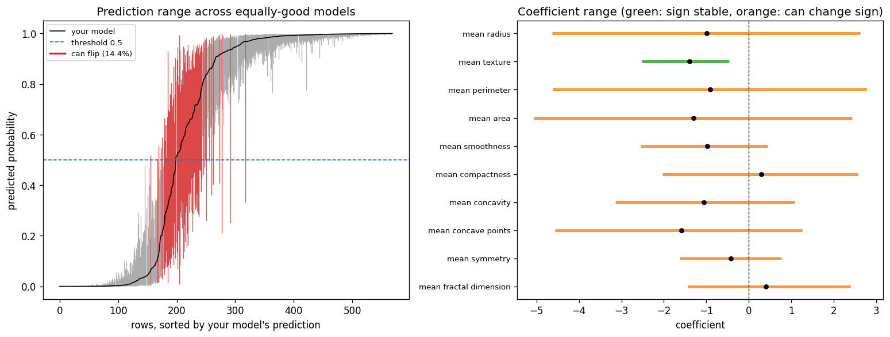
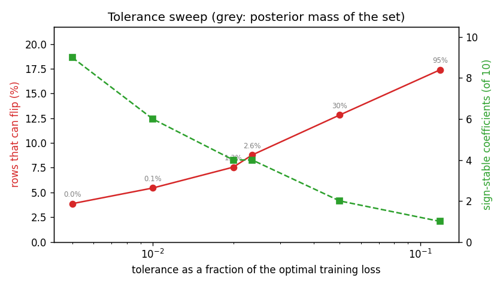
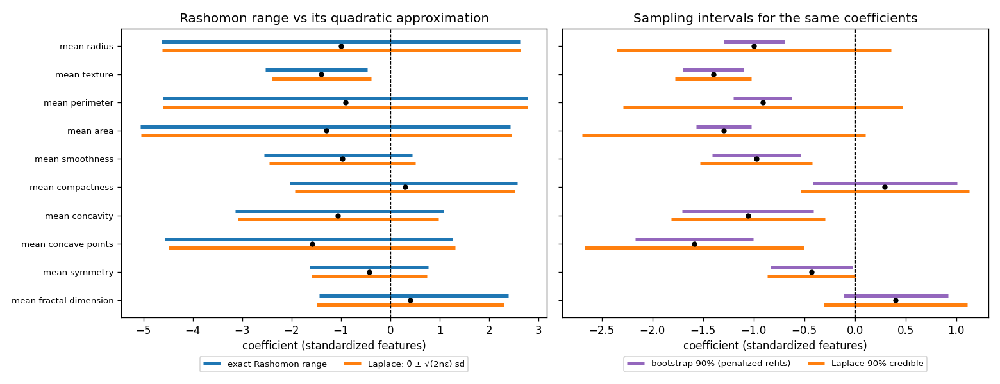

# Case study: the breast-cancer audit and the intervals it corresponds to

This page reproduces the README audit (scikit-learn's default `LogisticRegression()` on the ten
"mean" features of the Wisconsin breast-cancer data) and relates its output to three standard
objects: the Laplace posterior, profile-likelihood confidence intervals, and the bootstrap. For an
L2-penalized GLM each relation is an identity, stated below and checked on the numbers. The tables
are generated by `scripts/generate_tutorial_breast_cancer.py`; CI recomputes them and fails if they
no longer match.

## The audit

```python
from sklearn.datasets import load_breast_cancer
from sklearn.linear_model import LogisticRegression
from sklearn.pipeline import make_pipeline
from sklearn.preprocessing import StandardScaler
from rashomon import audit

data = load_breast_cancer(as_frame=True)
X, y = data.data.iloc[:, :10], data.target            # 1 = benign
model = make_pipeline(StandardScaler(), LogisticRegression()).fit(X, y)
report = audit(model, X, y, n_samples=2000, random_state=0)
print(report.summary())
```

<!-- generated: audit_summary -->
```text
Stability audit: LogisticRegression (classification), n=569, 10 features
Equally-good models: training log-loss within 0.01704 of the optimum 0.1435
  (one standard error of the 5-fold cross-validated log-loss, whose mean is 0.1458; models closer than this cannot be told apart by CV)
Method: hit-and-run sampling of the exact set (with ellipsoid proposals); 2,000 models, min ESS = 218 -> reliable

Predictions (flip test exact; disagreement over the sampled models)
  Flip under some equally-good model:           17.4%  (99 of 569)
  Worst single-model disagreement with yours:    5.1%

Coefficients (exact range across all equally-good models)
  feature                  estimate        low       high  sign
  mean radius               -0.9976     -4.634      2.621  UNSTABLE
  mean texture               -1.399     -2.527    -0.4664  stable
  mean perimeter            -0.9124     -4.613      2.775  UNSTABLE
  mean area                  -1.298     -5.061      2.433  UNSTABLE
  mean smoothness           -0.9745      -2.55     0.4395  UNSTABLE
  mean compactness           0.2935     -2.031      2.564  UNSTABLE
  mean concavity             -1.058     -3.139      1.079  UNSTABLE
  mean concave points        -1.587     -4.568      1.262  UNSTABLE
  mean symmetry              -0.428      -1.63      0.765  UNSTABLE
  mean fractal dimension     0.4021      -1.44      2.388  UNSTABLE
Sign stable: 1 of 10 features. Unstable: mean radius, mean perimeter, mean area, mean smoothness, mean compactness, mean concavity, mean concave points, mean symmetry, mean fractal dimension.

Note: the Hessian-ellipsoid approximation would misplace a coefficient bound by 12% of its half-width here; the exact ranges were needed
```
<!-- /generated -->

Texture is the only coefficient whose sign is the same in every model of the set. Radius, perimeter
and area are near-duplicates (perimeter is about 2πr, area about πr²), so the data determine their
combined effect but not its split, and the loss is nearly flat along those directions. The tolerance
is the default, one standard error of the cross-validated log-loss, which here is 11.9% of the
optimal loss. Every number in the report depends on that choice; the sweep below varies it.



## Which rows can flip

The flip test is exact per row: a row is flagged when a convex program finds a model in the set that
puts it on the other side of the threshold. Rows near the threshold are not the only ones flagged:

<!-- generated: affected -->
| rows with ... | rows | can flip | predicted probabilities of those that can flip |
|---|--:|--:|---|
| predicted probability between 0.2 and 0.8 | 71 | 71 (100%) | 0.200 to 0.788 |
| below 0.2 or above 0.8 | 498 | 28 (6%) | 0.037 to 0.968 |
<!-- /generated -->

All 71 rows with a predicted probability between 0.2 and 0.8 can flip, and so can 28 rows with
predicted probabilities as low as 0.037 or as high as 0.968. Under the quadratic approximation of
the loss, row $i$ can flip when $|x_i^\top\hat\theta| \le \sqrt{2\varepsilon}\,\lVert x_i \rVert_{H^{-1}}$,
so what matters is the distance to the threshold relative to the row's leverage along the poorly
determined directions. A tumour with extreme radius, perimeter and area has a wide prediction range
whatever its predicted probability. A rule based on the probability alone would miss those rows.

## Dependence on the tolerance

<!-- generated: tolerance_sweep -->
| `tolerance=` | ε | ε / loss | posterior mass of the set | flip rate (exact) | sign-stable coefficients |
|---|--:|--:|--:|--:|--:|
| `0.005` | 0.0007 | 0.5% | 0.0% | 3.9% | 9 of 10 |
| `0.01` | 0.0014 | 1.0% | 0.1% | 5.4% | 6 of 10 |
| `0.02` | 0.0029 | 2.0% | 1.3% | 7.6% | 4 of 10 |
| `0.05` | 0.0072 | 5.0% | 30.1% | 12.8% | 2 of 10 |
| `"cv"` (default) | 0.0170 | 11.9% | 94.6% | 17.4% | 1 of 10 |
| `("profile", 0.05)` | 0.0034 | 2.4% | 2.6% | 8.8% | 4 of 10 |

Smallest tolerance in the sweep at which each coefficient can change sign. compactness: `0.005`; radius, perimeter, fractal dimension: `0.01`; area, symmetry: `0.02`; concavity, concave points: `0.05`; smoothness: `"cv"` (default); texture: no tolerance in the sweep.
<!-- /generated -->

The sets are nested, so the flip rate rises and the number of sign-stable coefficients falls as
$\varepsilon$ grows. The "posterior mass" column is the probability that the Laplace posterior of
the fitted model assigns to the set, $F_{\chi^2_{11}}(2n\varepsilon)$ (section 1 below). At this
sample size a tolerance of 1% of the loss is a region of 0.1% posterior mass; the CV default is a
94.6% region. A percent-of-loss tolerance therefore means different things at different $n$, since
$2n\varepsilon$ grows with $n$ at a fixed percentage. The `"lr"` and `"profile"` calibrations scale
with $n$.

A conclusion should be reported with the tolerance at which it fails; the line under the table
gives it for each sign. The flip rate is 3.9% at 0.5% of the loss, a region of less than 0.1%
posterior mass.



## 1. The Rashomon set is a credible region

The fitted objective is $L(\theta) = \text{mean log-loss} + \tfrac{\lambda}{2}\lVert\theta\rVert^2$
with $\lambda = 1/(Cn)$ for scikit-learn's `C`. Then $nL(\theta)$ is a negative log-posterior: the
log-likelihood plus a Gaussian prior with precision $n\lambda$ (equal to 1 here, for `C=1` on
standardized features) on the coefficients and a flat prior on the intercept. $\hat\theta$ is its
mode, and the Laplace approximation to the posterior is $N(\hat\theta, (nH)^{-1})$ with $H$ the
Hessian of $L$ at $\hat\theta$. For an unpenalized fit this is the Wald approximation.

To second order, $\{\theta : L(\theta) \le L(\hat\theta) + \varepsilon\}$ equals
$\{\theta : (\theta-\hat\theta)^\top nH (\theta-\hat\theta) \le 2n\varepsilon\}$: the
$\varepsilon$-Rashomon set is the highest-posterior-density region of mass
$F_{\chi^2_d}(2n\varepsilon)$. Its projection onto coefficient $j$ is
$\hat\theta_j \pm \sqrt{2n\varepsilon}\,\mathrm{sd}_j$, with $\mathrm{sd}_j$ the posterior standard
deviation. The exact range can differ from this only through the non-quadratic part of the log-loss
inside the set:

<!-- generated: coefficients -->
| feature | estimate | exact low | exact high | sign | Laplace half-width √(2nε)·sd | exact / Laplace |
|---|--:|--:|--:|---|--:|--:|
| mean radius | -0.998 | -4.634 | 2.621 | **unstable** | 3.627 | 1.000 |
| mean texture | -1.399 | -2.527 | -0.466 | stable | 1.007 | 1.023 |
| mean perimeter | -0.912 | -4.613 | 2.775 | **unstable** | 3.694 | 1.000 |
| mean area | -1.298 | -5.061 | 2.433 | **unstable** | 3.749 | 0.999 |
| mean smoothness | -0.975 | -2.550 | 0.440 | **unstable** | 1.483 | 1.008 |
| mean compactness | 0.293 | -2.031 | 2.564 | **unstable** | 2.230 | 1.030 |
| mean concavity | -1.058 | -3.139 | 1.079 | **unstable** | 2.034 | 1.037 |
| mean concave points | -1.587 | -4.568 | 1.262 | **unstable** | 2.904 | 1.004 |
| mean symmetry | -0.428 | -1.630 | 0.765 | **unstable** | 1.166 | 1.027 |
| mean fractal dimension | 0.402 | -1.440 | 2.388 | **unstable** | 1.899 | 1.008 |

Tolerance ε = 0.0170; the set is a 94.6% HPD region of the Laplace posterior (d = 11 including the intercept, √(2nε) = 4.40).
<!-- /generated -->

The ratio in the last column lies between 1.000 and 1.037. On this data the log-loss is quadratic
inside the set to within 4%, and `coef_extremes()` returns $\sqrt{2n\varepsilon}\,\mathrm{sd}_j$ up
to that error. The exact computation differs from the closed form when the loss is not quadratic
inside the set: small samples, near-separation, or tolerances that are a large fraction of the loss.
The [evaluation](../evaluation.md) has a case at a tolerance of 34% of the loss where the quadratic
screen flags 36% of rows and the exact test 24%. `RashomonSet.compare_to_bayesian()` returns the
posterior, the HPD level of the current set (`hpd_level`) and these ratios.

## 2. The coefficient ranges are profile-likelihood intervals

With `tolerance=("profile", 0.05)`, $\varepsilon = \chi^2_1(0.95)/(2n)$. For an unpenalized fit
the range of coefficient $j$ over this set is its 95% profile-likelihood confidence interval:
maximizing $\theta_j$ subject to $L(\theta) \le L(\hat\theta) + \varepsilon$ minimizes the loss over
the other coordinates, which is what profiling does. `tests/test_validation.py` checks this against
R's `confint()` on the UCLA admissions data to 1e-4. At this tolerance "sign unstable" means that
the 95% profile interval covers zero. For the lightly penalized model here the correspondence is
approximate; 4 of 10 coefficients are sign-stable and 8.8% of the rows can flip. The set holds 2.6%
of the joint posterior mass: a 95% interval for one coordinate is the projection of a small joint
region, the usual gap between marginal and simultaneous inference.

## 3. The bootstrap

The bootstrap refits the penalized estimator on resampled rows. Its variance is approximately the
sandwich $(nH)^{-1} J (nH)^{-1}$, with $J = \sum_i (y_i - p_i)^2 x_i x_i^\top$ the empirical score
covariance; the Laplace posterior variance is $(nH)^{-1}$. The two agree when $\lambda = 0$ and the
model is well specified. With a penalty they differ along the directions the penalty controls: the
prior precision dominates the data's information there, so the posterior is wide, while the
estimator moves little between resamples because the penalty holds it in place.

<!-- generated: intervals -->
| feature | bootstrap sd | sandwich prediction | Laplace sd | Rashomon half-range |
|---|--:|--:|--:|--:|
| mean radius | 0.183 | 0.177 | 0.824 | 3.628 |
| mean texture | 0.183 | 0.174 | 0.229 | 1.030 |
| mean perimeter | 0.176 | 0.169 | 0.839 | 3.694 |
| mean area | 0.166 | 0.167 | 0.851 | 3.747 |
| mean smoothness | 0.267 | 0.237 | 0.337 | 1.495 |
| mean compactness | 0.433 | 0.415 | 0.506 | 2.298 |
| mean concavity | 0.395 | 0.316 | 0.462 | 2.109 |
| mean concave points | 0.354 | 0.339 | 0.659 | 2.915 |
| mean symmetry | 0.245 | 0.232 | 0.265 | 1.197 |
| mean fractal dimension | 0.314 | 0.302 | 0.431 | 1.914 |
<!-- /generated -->

The sandwich predicts the bootstrap standard deviations to within about 20%. For radius, perimeter
and area the Laplace sd is four to five times the bootstrap sd; for texture, which the data
determine well, the two differ by 25%. The Rashomon half-range is $\sqrt{2n\varepsilon} = 4.40$
times the Laplace sd (section 1).

The ratio of the Rashomon range to a 90% bootstrap interval is thus the product of two factors: the
tolerance, which here defines a 94.6% joint region rather than a 90% marginal interval, and the
ratio of posterior sd to sampling sd, which is large only along directions the penalty controls. A
width ratio quoted without this decomposition does not say which factor it measures. An earlier
version of this page quoted such ratios.



## What the audit adds

The audit does not measure a source of uncertainty absent from the posterior: at a given tolerance
the Rashomon set is a credible region of known level. Relative to a Wald table it provides

- exact coefficient ranges and an exact per-row flip test over the true set, which coincide with
  the closed forms when the loss is quadratic inside the set (as here) and differ from them when it
  is not; the ratio column shows which case applies;
- a per-row statement about an explicit competing model ("some model within $\varepsilon$ of yours
  gives this patient the other diagnosis"), with `functional_range` giving the row's exact
  prediction range and the sampler giving competing models to inspect;
- the conversion of a fitted scikit-learn model (`C`, intercept, class and sample weights,
  pipelines) into the objective whose sublevel set this is, with a check that the fitted
  coefficients are at its optimum;
- tolerances stated as a loss gap, a CV standard error, or a likelihood-ratio or profile level, with
  the corresponding posterior mass reported alongside.
